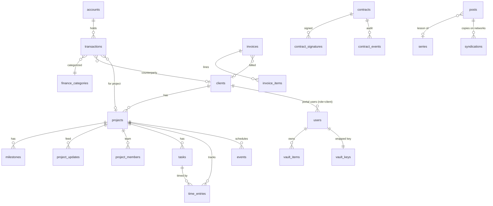

# Data model

Source of truth: `src/server/db/schema/*.ts` (Drizzle). Migrations: `drizzle/*.sql`
(generate with `pnpm db:generate`, applied automatically on boot).

Conventions: text ids (16 chars), `created_at`/`updated_at` as epoch-ms integers, money as
integer minor units + currency, JSON columns for tags/meta, soft-archive via `archived_at`.

## Domains

| File           | Tables                                                                        | Notes                                                                                                                                    |
| -------------- | ----------------------------------------------------------------------------- | ---------------------------------------------------------------------------------------------------------------------------------------- |
| `auth.ts`      | `users`, `sessions`, `api_tokens`                                             | roles owner/admin/member/client; sessions store sha256(token); API tokens store HMAC                                                     |
| `crm.ts`       | `clients`                                                                     | any counterparty: company / team / person                                                                                                |
| `projects.ts`  | `projects`, `project_members`, `milestones`, `project_updates`                | `share*` flags control the client portal; `share_token` → public status page                                                             |
| `work.ts`      | `tasks`, `time_entries`, `events`                                             | running timer = `ended_at IS NULL` (many may run at once); commitments are `events.kind = 'commitment'` with `client_id` + `promised_at` |
| `finance.ts`   | `accounts`, `finance_categories`, `transactions`, `invoices`, `invoice_items` | transfers use `transfer_account_id` (+ `transfer_amount_minor` for FX)                                                                   |
| `contracts.ts` | `contracts`, `contract_signatures`, `contract_events`                         | `content_hash` pins the signed text                                                                                                      |
| `vault.ts`     | `vault_keys`, `vault_items`                                                   | ciphertext only (client-side AES-GCM)                                                                                                    |
| `knowledge.ts` | `docs`                                                                        | tree via `parent_id`; visibility private / team / client                                                                                 |
| `content.ts`   | `posts`, `series`, `media`, `syndications`, `leads`, `testimonials`           | `posts.type`: article, tutorial, vlog, note, work, service, page; translations share `translation_key`                                   |
| `system.ts`    | `settings`, `notifications`, `activity_log`                                   | typed settings in `server/modules/settings`                                                                                              |
